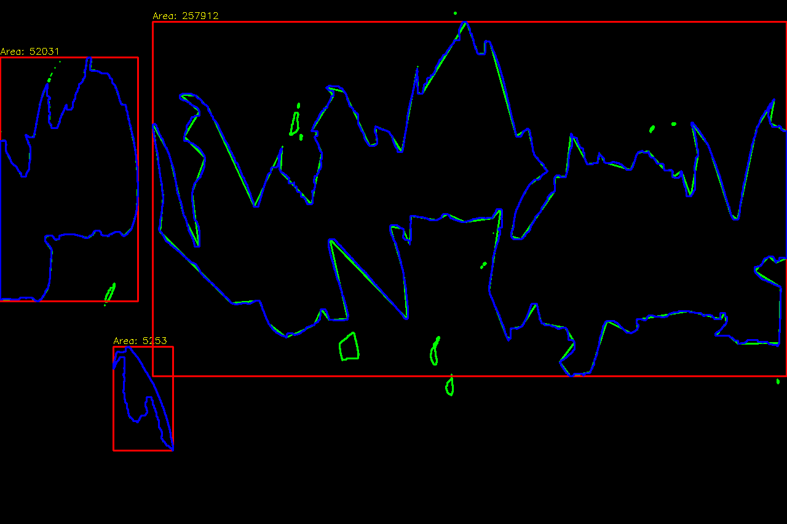

# 环境依赖
C++, Opencv, CMake, Eigen, Ceres

# 构建与执行命令
```bash
cmake -S . -B build
cmake --build build -j4
# 运行各程序
./build/task1_image
./build/task2_fit    
./build/task3_windmill resources/task_3.mp4 result/task3_windmill/task_3
./build/task3_windmill resources/task_4.mp4 result/task3_windmill/task_4
```

# 输入输出路径
### Task1
- 输入  resources/test_image.jpg
- 输出  result/task1_images
### Task2
- 输入  resources/task_2.mp4
- 输出  result/task2_fit
### Task3
- 输入  resources/task_3.mp4
- 输出  result/task3_windmill/task_3
### Task4
- 输入  resources/task_4.mp4
- 输出  result/task3_windmill/task_4

# 任务一分析
### 滤波图
- 核尺寸为 5
- 标准差：sigma = 0.3 * ((ksize - 1) * 0.5 - 1) + 0.8，约为 1.1
- 均值滤波：图像整体呈现出明显的模糊感，花瓣边缘变得柔和，产生了一定程度的过渡带，细小的纹理被平滑掉。
- 高斯滤波：相比均值滤波，整体更自然、清晰度保留得更好，在花瓣边缘处，距离边缘较远的像素权重更高，这使得边缘过渡比均值滤波更加平滑。
- 中值滤波：图像对比度最为强烈，锐度最高。在花瓣边缘（红绿交界）处，选择了红或绿像素中的一种，保留了边缘的锐利度，没有出现模糊过渡带。
### 红色提取图
- 阈值：(0, 50, 50)到(10, 255, 255)，(170, 50, 50)到(180, 255, 255)
- 红色：二值图中的白色区域与原始图像中郁金香花瓣的核心红色部分高度吻合，涵盖了大部分纯红色像素。
- 黄色：被剥离或分割，形成了明显的轮廓线。
- 阴影：被有效抑制，表现为纯黑，阈值将高亮度的红花与暗部阴影分离开来，避免了阴影对红色提取的干扰，但导致提取出的白色区域缺乏立体感。
### 形态学操作


# 结果索引
## Task1
### 灰度图
```bash
result/task1_images/gray.png
```
### h, s, v单通道图
```bash
result/task1_images/hsv_h.png
result/task1_images/hsv_s.png
result/task1_images/hsv_v.png
```
### 滤波图
```bash
result/task1_images/mean_filter.png
result/task1_images/gauss_filter.png
result/task1_images/median_filter.png
```
### 红色提取图
```bash
result/task1_images/red_mask.png
```
### 形态学操作图
```bash
result/task1_images/erode.png
result/task1_images/dilate.png
result/task1_images/close.png
result/task1_images/open.png
```
### 轮廓图
```bash
result/task1_images/contour_boxes.png
```
### 绘制与变换图
```bash
result/task1_images/draw.png
result/task1_images/rotated_35deg.png
/task1_images/crop_top_left.png
```
## Task2
### 标记视频
```bash
result/task2_fit/tracking_overlay.mp4
```
### 拟合曲线图
```bash
result/task2_fit/fit_comparison.png
```
### 残差图
```bash
result/task2_fit/residuals.png
```
## Task3
### Task3
```bash
result/task3_windmill/task_3/recognition_video.mp4
result/task3_windmill/task_3/binary_video.mp4
```
### Task4
```bash
result/task3_windmill/task_4/recognition_video.mp4
result/task3_windmill/task_4/binary_video.mp4
```