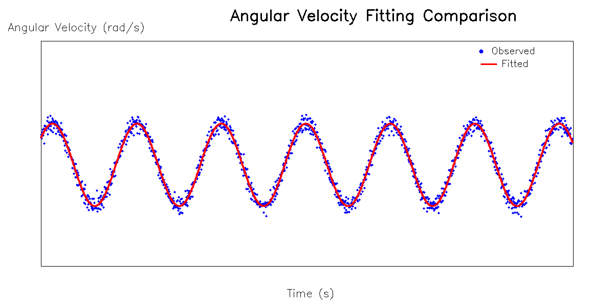
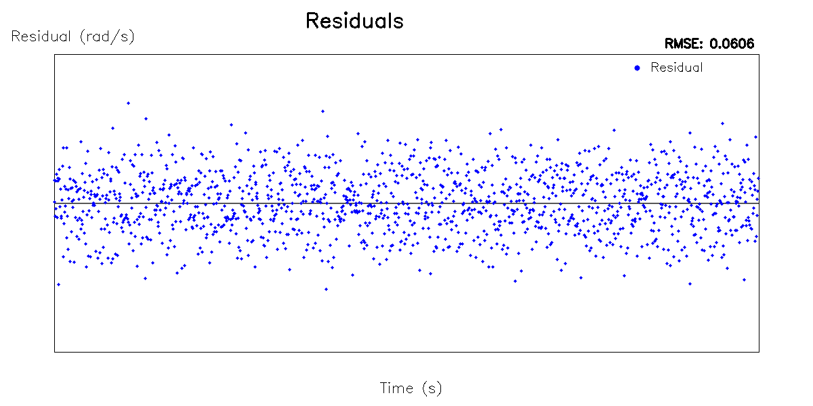

# Task2 分析报告
## 参数估计方法、约束与初值
- 选择拟合角速度模型：W = A sin(w*t+phi) + b;
- 约束：A > 0, b > A
- 对应初值：A = 0.7, b = 1.4, w = 1.8, phi = 0.5
- 优化方法：使用 Ceres Solver 进行非线性最小二乘优化。
- 求解状态：求解器配置：使用 DENSE_QR 线性求解器。程序输出显示 Termination: CONVERGENCE，经过 9 次迭代后成功收敛。最终 Cost 从 295.260 降至 3.974，收敛良好。
## 拟合结果分析
### 拟合结果
- A = 0.548928
- b = 1.34878
- omega = 1.65084
- phi = 0.708094
### 拟合曲线

红色曲线完美穿过了蓝色散点的中心趋势，表明模型对正弦波动特征拟合非常准确。
### 误差分析

残差围绕 0 轴上下随机波动，没有明显的周期性趋势或系统性偏差，主要分布在 [-0.1, 0.1] rad/s 的范围内，大部分残差幅度较小。
均方根误差 (RMSE)：程序计算并报告 RMSE = 0.0606 rad/s，远小于振幅 A (0.5489 rad/s)，预测精度较高。
### 数据说明
- 有效样本数：覆盖视频全程的帧数，拟合使用了全部有效数据帧。
- 参与计算的帧范围：基于视频第 0 帧为时间原点，数据涵盖了整个视频周期（约包含 7 个完整的正弦周期）。
- 单位说明：本报告中所有角速度误差单位均为 rad/s，时间单位为 s。

